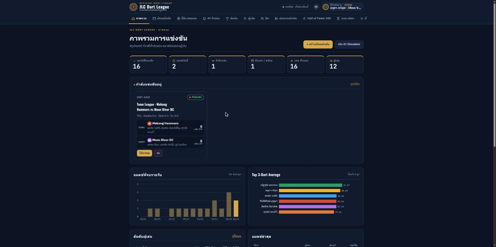
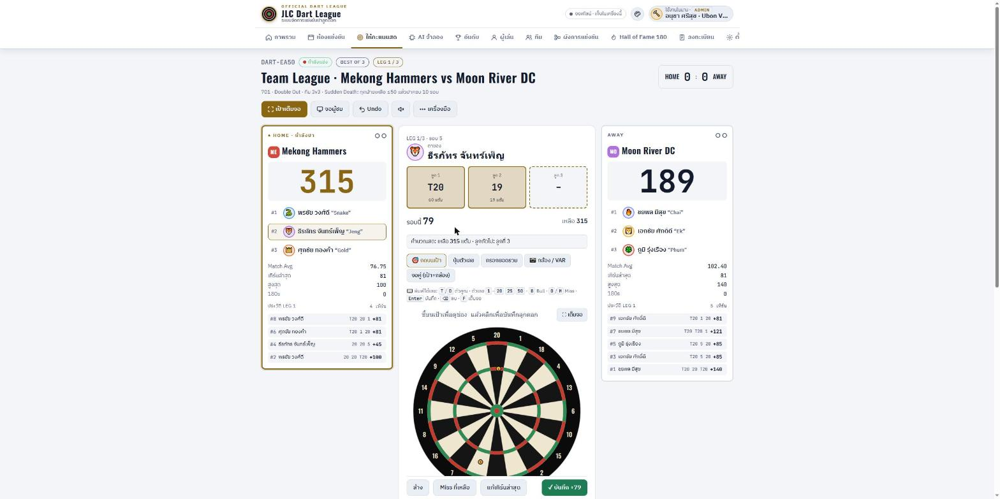
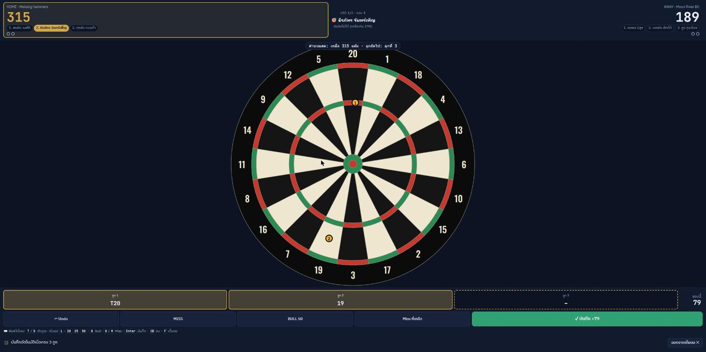
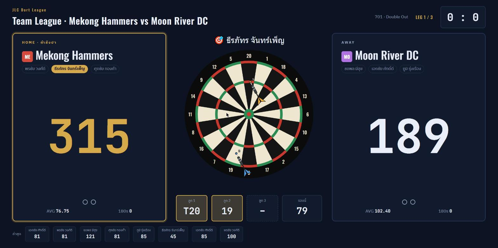
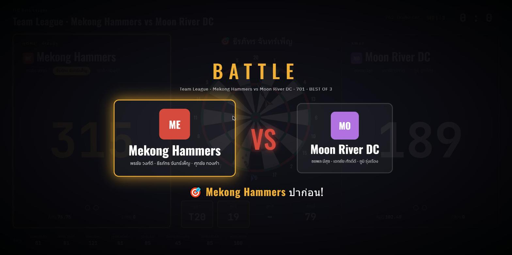
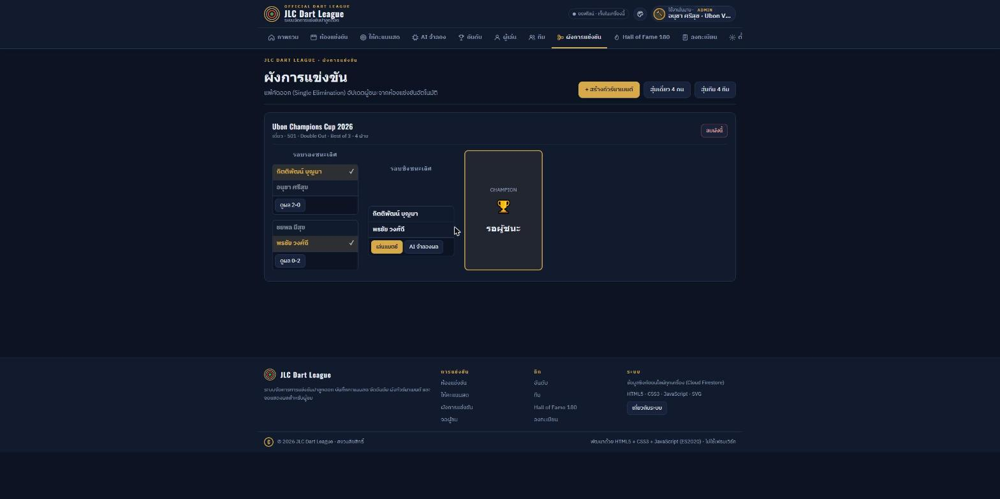
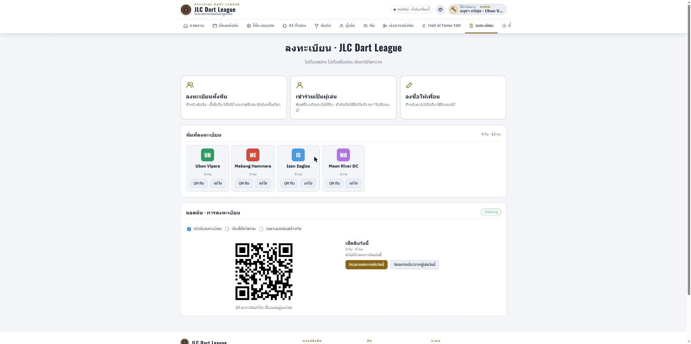

# JLC Dart League · ระบบจัดการแข่งขันปาลูกดอก

เว็บแอปภาษาไทยสำหรับ **จัดการแข่งขันปาลูกดอก (X01)** ตั้งแต่ลงทะเบียนผู้เล่น สร้างห้อง ให้คะแนนสดบนเป้า จัดอันดับ ไปจนถึงผังทัวร์นาเมนต์ และ **จอแสดงผลสำหรับผู้ชม** แบบมีแอนิเมชันและเสียง
**ไม่ต้องสมัคร ไม่ต้องล็อกอิน** สแกน QR ใส่ชื่อ เลือกทีม ก็แข่งได้ทันที (ล็อกอิน Google เป็นทางเลือก) ข้อมูลซิงก์ออนไลน์ทุกเครื่องแบบเรียลไทม์

**ใช้งานจริง:** https://jlc-dart-league.web.app (หรือ https://oche-dart-league.web.app)



---

## เมนูและความสามารถ

### ภาพรวม
- ตัวเลขสรุป: แมตช์ที่จบแล้ว แมตช์วันนี้ ห้องที่กำลังแข่ง ห้องรอ/พร้อม จำนวน 180 และจำนวนผู้เล่น
- การ์ดห้องที่ **กำลังแข่งขันอยู่** แบบสด, กราฟแมตช์ที่จบรายวัน (14 วัน), กราฟ Top 3-Dart Average
- ตารางอันดับผู้เล่น 5 อันดับแรก และแมตช์ล่าสุด (คลิกเพื่อเปิดดูผล)
- ถ้าต่อ **สองจอ** จะมีแถบชวนเปิด “จอผู้ชม” ขึ้นมาเอง

### ห้องแข่งขัน
- สร้างห้อง: ชื่อห้อง, **เดี่ยวหรือทีม**, **จำนวนฝ่าย 2–8** (1v1, 1v1v1 … หรือ 2–8 ทีม ทีมละ 2–4 คน), คะแนนเริ่ม 201–701, กติกาปิดเกม (Double / Single / Master Out), Best of 1–9, เงื่อนไข Sudden Death
- เว้นที่ว่างไว้ให้ผู้เล่นกด **“เข้าร่วมในนามฉัน”** เองได้ และมีช่อง **+ ผู้เล่นด่วน** เพิ่มชื่อคนมาใหม่ระหว่างสร้างห้อง
- ค้นหาจากชื่อห้อง / รหัส `DART-xxxx` / ชื่อผู้เล่น, กรองตามสถานะ (รอผู้เล่น · พร้อมแข่ง · กำลังแข่ง · จบแล้ว)
- การ์ดห้องแสดงทุกฝ่ายเป็นแถว พร้อมขาที่ชนะและคะแนนคงเหลือ, ปุ่มรีแมตช์

### ให้คะแนนสด


- ใส่คะแนนได้ 4 แบบ: **กดบนเป้า** (ลูกปักตรงจุดที่คลิก), ปุ่มตัวเลข + ตัวคูณ, **กรอกยอดรวม** แบบป้ายคะแนนในร้าน, และ **คีย์บอร์ด**
- คำนวณสด: คะแนนคงเหลือ, **BUST พร้อมเหตุผล** (เกินแต้ม / เหลือ 1 / ลูกสุดท้ายไม่ใช่ Double), GAME SHOT, 180
- **แนะนำทางปิดเกม** 3 แบบเรียงตามความนิยม (เช่น 121 → T20 · T15 · D8)
- ประวัติเทิร์นแยกแต่ละฝั่ง + บันทึกทั้งแมตช์, Undo ดึงลูกของเทิร์นล่าสุดกลับมาแก้ได้
- เมนู **เครื่องมือ**: Face-off / เลือกคนเริ่ม (มีวงล้อสุ่ม), จัดลำดับการปาของทีม, Sudden Death (ดวล Bull วัดระยะเป็นมิลลิเมตร), **กรรมการแก้คะแนน** (ต้องใส่เหตุผล เก็บ Audit Log), ผู้ประกาศคะแนน (Caller)
- **Sudden Death**: เริ่มนับรอบเมื่อ *ทุกฝ่าย* เหลือ ≤ 50 (ตั้งค่าได้) ครบรอบที่กำหนดแล้วเด้งหน้าดวลให้อัตโนมัติ
- แอนิเมชัน + เสียง: ลูกดอกแต่ละแบบเสียงต่างกัน, **ฉาก GAME SHOT ทุกครั้งที่จบ Leg**, ฉากฉลองผู้ชนะแมตช์, เอฟเฟกต์ 180
- กล้อง / VAR: เลือกกล้อง, กลับด้าน, เส้นเป้าเล็ง, ถ่ายภาพประกอบการตัดสิน, โหมดจอคู่ (เป้า + กล้อง)

**คีย์ลัด (ใช้ได้แม้แป้นพิมพ์เป็นภาษาไทย)**

| ปุ่ม | ความหมาย |
|---|---|
| `T` / `D` / `S` | ตัวคูณ Treble / Double / Single (หรือ `*` `/` `-` บนแป้นตัวเลข) |
| `1`–`20`, `25`, `50` | ช่องที่ปักโดน (พิมพ์ `T` `2` `0` = T20) |
| `B` | Bull (กด `D` ก่อน = Bullseye 50) |
| `0` / `M` | Miss |
| `Enter` | บันทึกเทิร์น |
| `Backspace` | ลบลูกล่าสุด / ลบตัวเลขที่กำลังพิมพ์ |
| `F` | เป้าเต็มจอ |

### เป้าเต็มจอ


ทุกอย่างอยู่ในจอเดียว ไม่ต้องเลื่อน: คะแนนคงเหลือและรายชื่อทุกคน (คนที่กำลังปาไฮไลต์), ทางปิดเกม, เป้าใหญ่, ช่องลูก 1–3, ปุ่มบันทึก และตัวเลือก **บันทึกอัตโนมัติเมื่อครบ 3 ลูก** ใช้บนมือถือได้

### จอผู้ชม (โหมดสองจอ)



- ต่อจอที่สอง (ทีวี/โปรเจกเตอร์) ระบบ **ตรวจพบเอง** แล้วเปิดจอผู้ชมไปที่จอนั้น (Chrome / Edge) หรือกดปุ่ม “จอผู้ชม”
- จอผู้ชมเป็นแสดงผลอย่างเดียว ซิงก์กับจอควบคุมทันที (เครื่องเดียวกันหรือคนละเครื่อง)
- **ลูกดอกบินไปปักเป้า ตรงจุดที่กดบนจอควบคุม** พร้อมเสียง
- **ฉาก BATTLE**: การ์ดผู้เล่น/ทีมพุ่งเข้ามา, VS, วงล้อสุ่มคนเริ่มก่อน
- ฉาก GAME SHOT ทุก Leg, ฉากฉลองผู้ชนะ (ถ้วย + พลุ + เสียง), เอฟเฟกต์ 180
- ตอนยังไม่เริ่มแข่ง แสดง **QR สแกนเพื่อลงทะเบียน** + โลโก้ทีมที่ลงทะเบียนแล้ว

### AI จำลอง
จำลองแมตช์ระหว่าง AI 4 ระดับ (Professional / Advanced / Intermediate / Beginner) ปรับความเร็ว ×1–×8 หยุด/ต่อ/รีเซ็ต ผลไม่นับในสถิติจริง

### อันดับ
อันดับรายบุคคล (เรียงตาม 3-Dart Avg, ชนะ, Win %, สูงสุด, Best Checkout, 180s) และ **อันดับรายทีม** คลิกชื่อเพื่อดูโปรไฟล์

### ผู้เล่น / โปรไฟล์
- ทะเบียนผู้เล่น พร้อมทีมและบทบาท, **เพิ่มหลายคนพร้อมกัน** (บรรทัดละคน), ลิงก์ / QR เชิญผู้เล่น
- **รูปโปรไฟล์**: อัปโหลดหรือถ่ายรูป หรือใช้รูปจากบัญชี Google
- หน้าโปรไฟล์: สถิติ 10 ช่อง, กราฟแนวโน้มค่าเฉลี่ยรายแมตช์, แมตช์ล่าสุด

### ทีม
ทีมพร้อม **โลโก้** สีประจำทีม และกัปตัน · กัปตันแก้ไขทีมตัวเองได้ (เพิ่ม/ถอดลูกทีม, เปลี่ยนโลโก้, เรียงลำดับมือ) และสร้าง **QR ประจำทีม** ได้ · แอดมินจัดการได้ทุกทีม

### ผังการแข่งขัน


แพ้คัดออก (Single Elimination) จับฉลากอัตโนมัติ ใส่ BYE ให้เองเมื่อจำนวนไม่ครบ ผู้ชนะจากห้องแข่งเลื่อนรอบให้อัตโนมัติ มีปุ่ม “AI จำลองผล” และสุ่มผังด่วน 4 คน / 4 ทีม

### Hall of Fame 180
อันดับผู้ทำ 180 สูงสุด และไทม์ไลน์ 180 ล่าสุด

### ลงทะเบียน


| วิธี | สำหรับ | ขั้นตอน |
|---|---|---|
| **ลงทะเบียนทั้งทีม** | กัปตัน | ตั้งชื่อทีม ใส่โลโก้ ใส่ชื่อตัวเองและรายชื่อสมาชิกบรรทัดละคน → **ทั้งทีมพร้อมแข่งทันที** ลูกทีมไม่ต้องสแกนหรือยืนยัน มีปุ่ม “สร้างห้องแข่งให้ทีมนี้” ต่อได้เลย |
| **เข้าร่วมเป็นผู้เล่น** | ผู้เล่นที่มีมือถือ | พิมพ์ชื่อ แตะโลโก้ทีม (ถ้ากัปตันใส่ชื่อไว้แล้ว กด “ฉันคือคนนี้”) |
| **QR ประจำทีม** (ไม่บังคับ) | ลูกทีมที่อยากดูสถิติในมือถือตัวเอง | สแกน → แตะชื่อตัวเอง เสร็จ |
| **ลงชื่อให้เพื่อน** | คนไม่มีมือถือ | ใส่ชื่อแทน ภายหลังเจ้าตัวกด “ฉันคือคนนี้” ได้ |
| **ล็อกอิน Google** | ไม่บังคับ | เก็บสถิติข้ามเครื่อง (ผูกบัญชีทีหลังได้ ข้อมูลไม่หาย) |

แอดมิน: เปิด/ปิดรับลงทะเบียน, **รหัสงาน 4 หลัก** กันคนนอก, เฉพาะแอดมินสร้างทีม, **เช็คอินวันนี้** แบบสด และจับฉลากผังจากทีม/ผู้เล่นที่ลงทะเบียนวันนี้

### ตั้งค่า
ชื่อลีก, ค่าเริ่มต้นของห้อง (คะแนน กติกาปิดเกม Best of Sudden Death), สำรอง/นำเข้าข้อมูล (JSON), รีเซ็ตระบบ, Audit Log การแก้คะแนนของกรรมการ, เชื่อมต่อฐานข้อมูลออนไลน์

### ธีม
19 ธีม — **มาตรฐานลีก (กรมท่า–ทอง, สว่าง/มืดตามเครื่อง)** + ธีมสว่าง 8 แบบ + ธีมมืด 10 แบบ (รวม High Contrast) จำแยกตามเครื่อง

---

## บทบาทและสิทธิ์

| บทบาท | ทำอะไรได้ |
|---|---|
| ผู้ชม (ไม่ได้ลงทะเบียน) | ดูทุกหน้า สกอร์สด อันดับ ผังการแข่งขัน จอผู้ชม |
| ผู้เล่น (ลงทะเบียนแบบไม่ล็อกอิน หรือ Google) | สร้าง/เข้าร่วมห้อง ให้คะแนน แก้โปรไฟล์ตัวเอง เปลี่ยนทีม |
| กัปตันทีม | + จัดการทีมตัวเอง (สมาชิก โลโก้ ลำดับมือ QR ทีม) |
| กรรมการ | + แก้คะแนนพร้อมเหตุผล ลบห้อง |
| แอดมิน | ทุกอย่าง: จัดการผู้เล่น/ทีม/ผัง ตั้งค่า การลงทะเบียน รหัสงาน ตั้งบทบาท |

แอดมินระบุด้วยอีเมล Google ใน `firestore.rules` (ไฟล์บน GitHub เว้นอีเมลไว้เป็น `ADMIN_EMAIL`)

## ความปลอดภัย

- สิทธิ์ทั้งหมดบังคับที่ฐานข้อมูลด้วย **Firestore Security Rules** ไม่ใช่แค่ซ่อนปุ่ม — แก้ทีมคนอื่น เปลี่ยนบทบาทตัวเอง หรือแก้ผู้เล่นที่ผูกกับมือถือคนอื่น จะถูกปฏิเสธ
- ผู้เล่นแบบไม่ล็อกอินใช้ Firebase Anonymous Auth (บัตรผ่านเฉพาะเครื่อง) ไม่เก็บอีเมลผู้เล่นในฐานข้อมูลสาธารณะ
- รหัสงานเก็บเป็นเอกสารที่อ่านไม่ได้ ระบบแค่ตรวจว่ามีอยู่จริง
- รูปโลโก้/โปรไฟล์ย่อในเบราว์เซอร์ และรับเฉพาะ `data:image/…` หรือรูปจาก Google เท่านั้น

## โครงสร้างโปรเจกต์

| ไฟล์ | หน้าที่ |
|---|---|
| `index.html` | ทั้งแอป (HTML + CSS + JavaScript ล้วน ไม่ใช้เฟรมเวิร์ก) |
| `config.js` | ค่าเชื่อมต่อ Firebase (`window.OCHE_FIREBASE`) — ถ้าเป็น `null` จะทำงานแบบออฟไลน์ เก็บข้อมูลในเครื่อง |
| `firestore.rules` | กฎความปลอดภัยของฐานข้อมูล |
| `firebase.json` | ตั้งค่า Firebase Hosting + Rules |
| `icon-*.png`, `favicon.png` | ไอคอนเว็บ / หน้าจอหลักมือถือ |
| `docs/` | ภาพหน้าจอใน README |

## ขึ้นเว็บเอง (Firebase · ฟรี)

1. สร้างโปรเจกต์ที่ https://console.firebase.google.com แล้วเปิด
   - Authentication → Sign-in method → **Google** และ **Anonymous**
   - Firestore Database (Production mode)
   - เพิ่ม Web app แล้วคัดลอก `firebaseConfig`
2. ใส่ค่าใน `config.js`
   ```js
   window.OCHE_FIREBASE = { apiKey: "...", authDomain: "...", projectId: "...", storageBucket: "...", messagingSenderId: "...", appId: "..." };
   ```
3. แก้ `'ADMIN_EMAIL'` ใน `firestore.rules` เป็นอีเมล Google ของแอดมิน
4. Deploy
   ```bash
   npm install -g firebase-tools
   firebase login
   firebase deploy --only hosting,firestore:rules --project <project-id>
   ```
5. เปิดเว็บ ล็อกอิน Google ด้วยอีเมลแอดมิน → ได้สิทธิ์แอดมินอัตโนมัติ

## ทดลองบนเครื่องตัวเอง

ไม่ต้องติดตั้งอะไร เปิดผ่านเว็บเซิร์ฟเวอร์ธรรมดาได้เลย (โหมดออฟไลน์ มีข้อมูลตัวอย่างให้ลอง)

```bash
python -m http.server 8080
```
แล้วเปิด http://localhost:8080 — หรือดูเวอร์ชันออฟไลน์บน GitHub Pages: https://jlcchannal.github.io/oche-dart-league/

## เทคโนโลยี

HTML5 · CSS3 · JavaScript (ES2020) ล้วน · SVG (เป้า กราฟ ไอคอน) · Web Audio + Speech Synthesis (เสียง) · Canvas (พลุ) · BroadcastChannel (ซิงก์จอผู้ชมในเครื่องเดียวกัน) · Window Management API (ตรวจจอที่สอง) · Firebase Hosting / Auth / Cloud Firestore

## ประวัติการอัปเดต

| วันที่ | สิ่งที่เพิ่ม/แก้ |
|---|---|
| 27 พ.ย. 2026 | กัปตันลงทะเบียนทีมแล้วพร้อมแข่งทันที ลูกทีมไม่ต้องสแกน QR ยืนยัน, หน้า “ทีมพร้อมแข่งแล้ว” + ปุ่มสร้างห้องให้ทีม |
| 26 พ.ย. 2026 | หน้าตาแบบทางการ (กรมท่า–ทอง, ไอคอนเส้น, ตราลีก, ส่วนท้ายแบบคอลัมน์) |
| 26 พ.ย. 2026 | อ่านง่ายขึ้น (ตัวอักษร/ปุ่มใหญ่ขึ้น, เมนูเครื่องมือ), ฉาก GAME SHOT ทุก Leg + ฉลองผู้ชนะบนจอควบคุม |
| 26 พ.ย. 2026 | เปลี่ยนชื่อเป็น JLC Dart League, ไอคอนเว็บ, ที่อยู่ใหม่ jlc-dart-league.web.app |
| 26 พ.ย. 2026 | รูปโปรไฟล์, จอผู้ชม: ลูกดอกบินปักเป้า ฉาก BATTLE + วงล้อสุ่ม ฉลองผู้ชนะ |
| 26 พ.ย. 2026 | ธีมเพิ่มเป็น 19 แบบ, แก้ชื่อซ้อนในการ์ดห้อง |
| 26 พ.ย. 2026 | ลงทะเบียนแบบไม่ล็อกอิน (กัปตันลงทั้งทีม, โลโก้ทีม, QR ทีม, รหัสงาน, เช็คอิน), ให้คะแนนด้วยคีย์บอร์ด |
| 26 พ.ย. 2026 | โหมดหลายคน 2–8 ฝ่าย, โหมดสองจอ (จอผู้ชม) |
| 26 พ.ย. 2026 | ล็อกอิน Google + สิทธิ์แอดมิน/กรรมการ, ขึ้น Firebase Hosting |
| 26 พ.ย. 2026 | เป้าเต็มจอ, Sudden Death แบบดวล Bull, เสียง/Caller, ทางปิดเกม |
| 26 พ.ย. 2026 | เวอร์ชันแรก: ครบทุกเมนู ภาพรวม ห้อง ให้คะแนน AI อันดับ ทีม ผัง Hall of Fame ตั้งค่า |

---

© 2026 JLC Dart League · สงวนลิขสิทธิ์
